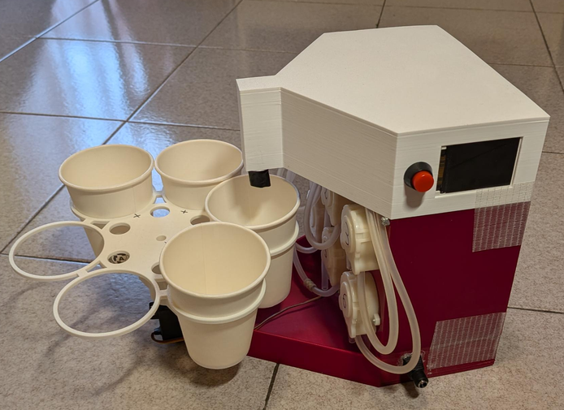

# FluidSync

**FluidSync** is an automatic fluid mixer that can create mixtures with up to **6 different fluids**. Thanks to its precision peristaltic pumps, each mix is accurate down to the milliliter.

The firmware runs on a Raspberry Pi Pico W, uses **FreeRTOS** (SMP, dual core) for real-time pump and carousel control, and **LVGL** to show the machine status on a 320x240 TFT display (display only, no touch). The only user input is a single push button.

> This project was developed for the **Real-Time Embedded Systems** course at **UniMORE** (University of Modena and Reggio Emilia).

## Features

- Up to 6 liquids per mix, each driven by its own peristaltic pump
- Mixes defined as percentages (100 ml per mix, 1% = 429 ms of pump time)
- Rotating carousel with 4 cup slots, moved by a servo motor
- Automatic cup detection with an ultrasonic distance sensor
- Order queue (up to 10 pending orders) served in the background
- Single-button user interaction to load/unload cups
- Live status UI: pump states, mix progress, carousel slots, queue length, completed mixes
- Dual-core task design: dispensing and carousel on core 1, orders, button and display on core 0

## How it works

1. A new order (a mix with the percentage of each liquid) is pushed into the order queue.
2. The carousel manager rotates the carousel and checks each slot with the ultrasonic sensor to find an empty cup.
3. When a cup is in position, the dispenser queues one job per liquid used in the mix.
4. A pool of pump worker tasks runs the pumps in parallel, each for a time proportional to its percentage.
5. When all pumps are done, the slot is marked as full. Pressing the button releases the carousel so the user can remove the full cups and load empty ones; pressing it again resumes operation.

If a mix is being dispensed when the button is pressed, the request is served right after the mix ends. If no empty cup is found, the machine waits for the user to reload the carousel.

> **Note:** orders are currently generated at random intervals (5 to 30 s) from a set of 6 predefined test mixes, to simulate incoming requests. Replace `orders_task0A` in `FluidSync.c` with your own order source.

## Hardware

| Component | Details |
|---|---|
| Microcontroller | Raspberry Pi Pico W (RP2040) |
| Pumps | 6x peristaltic pumps |
| Carousel | Servo motor, 4 cup slots |
| Cup detection | Ultrasonic distance sensor (trigger/echo) |
| Display | SPI TFT, 320x240 landscape, no touch |
| User input | 1 push button |

Pump order: `0 = yellow, 1 = magenta, 2 = cyan, 3 = white, 4 = black, 5 = water`.

### Pinout (GPIO)

| Function | GPIO |
|---|---|
| Pump 1 | 12 |
| Pump 2 | 11 |
| Pump 3 | 14 |
| Pump 4 | 15 |
| Pump 5 | 13 |
| Pump 6 | 10 |
| Carousel servo | 8 |
| Distance sensor TRIG | 6 |
| Distance sensor ECHO | 7 |
| Unload button | 9 |
| TFT SDA (SPI0 TX) | 18 |
| TFT SCL (SPI0 SCK) | 19 |
| TFT RST | 20 |
| TFT DC | 21 |
| TFT CS | 22 |

All pin definitions and timing constants are in `FluidSyncHW.h`.

## Project structure

```
FluidSync/
├── 3dStructure/        # Mechanical structure (3D files)
├── FreeRTOS-Kernel/    # FreeRTOS kernel (git submodule)
├── FluidSync.c         # Main logic: tasks, order queue, carousel and dispenser management
├── FluidSyncHW.c/.h    # Hardware abstraction: pumps, servo, sensor, button, display driver
├── FluidSyncUI.c/.h    # LVGL user interface
├── FreeRTOSConfig.h    # FreeRTOS configuration
├── lv_conf.h           # LVGL configuration
├── CMakeLists.txt      # Build configuration
└── pico_sdk_import.cmake
```

## Software architecture

| Task | Core | Role |
|---|---|---|
| `dispenser_task1A` | 1 | Takes orders from the queue and dispatches pump jobs |
| `carousel_task1B` | 1 | Finds an empty cup and moves the carousel into position |
| `pump_worker_task1C` (x2) | 1 | Worker pool that runs the pumps (highest priority, low start/stop latency) |
| `orders_task0A` | 0 | Generates orders |
| `user_button_task0B` | 0 | Handles the button and carousel unloading |
| `display_task0C` | 0 | Collects a state snapshot and updates the LVGL UI |

Synchronization is done with FreeRTOS semaphores, mutexes and a queue. LVGL is only ever called from the display task, since it is not thread-safe.

## Build

### Requirements

- [Raspberry Pi Pico SDK](https://github.com/raspberrypi/pico-sdk) 2.2.0
- CMake 3.13+
- ARM GCC toolchain
- [Raspberry Pi Pico VS Code extension](https://marketplace.visualstudio.com/items?itemName=raspberry-pi.raspberry-pi-pico) (optional, recommended)

### Steps

```bash
git clone --recurse-submodules https://github.com/FrancescoPietri/FluidSync.git
cd FluidSync
mkdir build && cd build
cmake ..
make -j4
```

If you already cloned without submodules:

```bash
git submodule update --init --recursive
```

The build produces `FluidSync.uf2`.

### Flash

1. Hold the **BOOTSEL** button on the Pico W and plug it into USB.
2. Copy `build/FluidSync.uf2` to the `RPI-RP2` drive.

Debug output is available over USB serial (UART stdio is disabled).

## Configuration

Useful constants in the source:

| Constant | File | Meaning |
|---|---|---|
| `TIME_PER_PERCENT_MS` | `FluidSync.c` | Pump time per 1% of a 100 ml mix (calibrate it for your pumps) |
| `N_MAX_ORDER` | `FluidSync.c` | Maximum number of queued orders |
| `ORDER_MIN/MAX_INTERVAL_MS` | `FluidSync.c` | Interval of the random test orders |
| `CUP_MAX_DISTANCE_CM` | `FluidSyncHW.h` | Distance threshold to detect a cup |
| `CAROUSEL_CUPS_SLOTS` | `FluidSyncHW.h` | Number of cup slots |

To add a new mix, add an entry to `test_mixes[]` with the percentage of each liquid (the percentages should sum to 100).

## Author

[Francesco Pietri](https://github.com/FrancescoPietri)